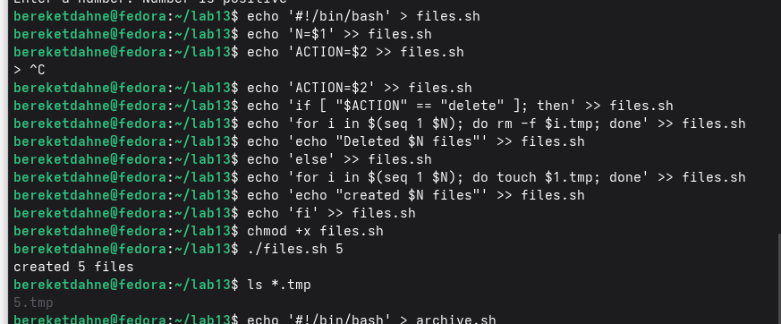

---
title: "Лабораторная работа № 13"
author: "Bereket Dagne"
date: "2026-10-04"
lang: ru
mainfont: "DejaVu Serif"
monofont: "DejaVu Sans Mono"
pdf-engine: xelatex
---

# Лабораторная работа № 13
## Программирование в командном процессоре ОС UNIX. Ветвления и циклы

---

### Цель работы
Изучить основы программирования в оболочке ОС UNIX. Научиться писать более сложные командные файлы с использованием логических управляющих конструкций и циклов.

---

### Выполнение работы

#### Задание 1. Скрипт с getopts и grep

Скрипт `search.sh`:
```bash
#!/bin/bash
INPUT=""
PATTERN=""
while getopts "i:p:" opt
do
case $opt in
i) INPUT=$OPTARG ;;
p) PATTERN=$OPTARG ;;
esac
done
grep $PATTERN $INPUT
```

Результат: найдена строка "Hello World" в файле `test.txt`.

#### Задание 2. Программа на Си с exit()

Программа `check.c`:
```c
#include <stdio.h>
#include <stdlib.h>

int main() {
    int num;
    printf("Enter a number: ");
    scanf("%d", &num);
    
    if (num > 0) {
        exit(1);
    } else if (num < 0) {
        exit(2);
    } else {
        exit(0);
    }
}
```

Скрипт `checknum.sh`:
```bash
#!/bin/bash
echo -n "Enter number: "
read num
echo $num | ./check
case $? in
0) echo "Number is zero" ;;
1) echo "Number is positive" ;;
2) echo "Number is negative" ;;
esac
```

Результат: при вводе 5 выведено "Number is positive".

#### Задание 3. Создание и удаление N файлов

Скрипт `files.sh`:
```bash
#!/bin/bash
N=$1
ACTION=$2
if [ "$ACTION" == "delete" ]; then
for i in $(seq 1 $N); do rm -f $i.tmp; done
echo "Deleted $N files"
else
for i in $(seq 1 $N); do touch $i.tmp; done
echo "Created $N files"
fi
```

Результат: создано 5 файлов (5.tmp и другие).

#### Задание 4. Архивация файлов с tar и find

Скрипт `archive.sh`:
```bash
#!/bin/bash
DIR=$1
ARCHIVE=$2
find $DIR -type f -mtime -7 > filelist.txt
tar -czvf $ARCHIVE -T filelist.txt
rm filelist.txt
echo "Archive created: $ARCHIVE"
```

Результат: создан архив `backup.tar.gz` (3466 байт).

---

### Результаты работы

**Скриншот 1:** Запуск скрипта search.sh


{ width=4in }

\newpage

**Скриншот 2:** Запуск checknum.sh


{ width=4in }

\newpage

**Скриншот 3:** Создание файлов


{ width=4in }

\newpage

**Скриншот 4:** Архивация файлов


{ width=4in }

---

### Ответы на контрольные вопросы

**1. Каково предназначение команды getopts?**

`getopts` используется для синтаксического анализа командной строки, выделяя флаги и их аргументы.

**2. Какое отношение метасимволы имеют к генерации имён файлов?**

Метасимволы (`*`, `?`, `[ ]`) используются для генерации имён файлов путём подстановки шаблонов.

**3. Какие операторы управления действиями вы знаете?**

`if`, `case`, `while`, `until`, `for`, `break`, `continue`.

**4. Какие операторы используются для прерывания цикла?**

`break` — завершает цикл. `continue` — завершает текущую итерацию.

**5. Для чего нужны команды false и true?**

`true` всегда возвращает код 0 (истина). `false` всегда возвращает ненулевой код (ложь).

**6. Что означает строка if test -f man$i.\$s, встреченная в командном файле?**

Проверяет, существует ли файл с именем `mani.s`.

**7. Объясните различия между конструкциями while и until.**

`while` выполняется, пока условие истинно. `until` выполняется, пока условие ложно.

---

### Выводы

В ходе выполнения лабораторной работы № 13 я изучил основы программирования в оболочке ОС UNIX. Я научился писать более сложные командные файлы с использованием логических управляющих конструкций и циклов.

Таким образом, цель работы была полностью достигнута.
```

---

